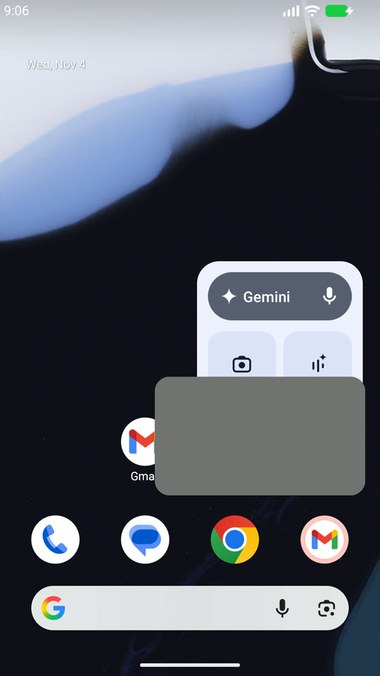
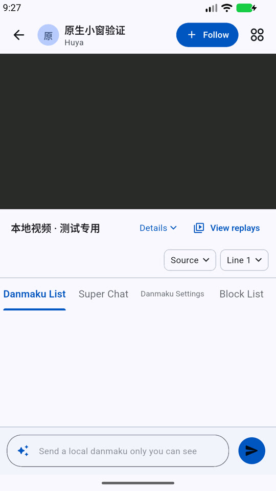

# A07.42

按任务书分别记录源/样本/组件/编译/模拟器/物理设备/公开发布证据，当前尚未验收。

2026-11-04原生复核：同代码预检profile、独立入口、API37自有模拟器（非原Honor设备）。自动小窗关闭：返回应用内小窗后Home无外部PiP；开启后Home进入PiP。标准系统把PiP任务排除在最近任务卡片之外，使用同签名、独立Instrumentation调用本应用AppTask.finishAndRemoveTask，非force-stop。先清理自有生成测试任务，明确当前任务号，移除前确认在PiP且音频服务1个。

第一轮捕获真实退出竞态：已销毁Activity仍收到setPlaying并注册pipReceiver，触发IntentReceiverLeaked；重复idle向已销毁AudioService.setState写入出现NullPointerException。修复为PiP通道在Activity finishing/destroyed时返回安全结果，不再注册或操作窗口；回调结束仅在尚非idle时发布idle。失败完整日志本地保留，非门禁例外。

复验在Instrumentation结束前确认Dart taskRemoved回调、hide通知、原生VideoOutputManager.dispose、Activity销毁、音频服务1→0，无上述接收器泄漏/空指针；之后同进程重新打开Activity仍存活且不是PiP。截图在本地，原生预检文件SHA记录防止后续变更冒充已验证。正式同源包及正常入口冒烟仍由发布统一执行。未操作K90/正式安装，未覆盖原MagicOS厂商最近任务实现。

