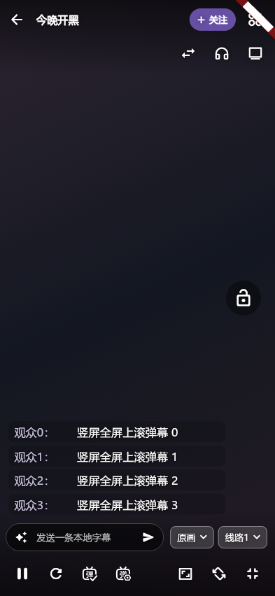

# A08.17

实现#193：仅在竖屏全屏提供左下角从下向上滚动的弹幕布局，默认保持原从右向左。复用同一消息流、过滤与字体/透明度设置，不建立第二弹幕连接。左对齐、紧凑、有限行数/图片解码，不遮底部工具栏/安全区，支持大字号与锁屏控制、弹层、暂停、弹幕开关和退出恢复。沿用现有主题、字体、画质/线路紧凑菜单；通过实际生产组件竖屏/窄屏截图审阅。

2026-11-04：按用户指定frontend-design/art-direction，在原直播间加入可选左下角上滚，默认rolling不变。视觉沿用视频前景白色#FFFFFF与scrim黑色#000000，昵称由主题primary与视频前景混合提高对比度，行底仅18% scrim；无新大弹窗。左边12、底部避开工具栏与安全区，宽82%并不超过340，高不超过36%/320；最多6行、2行文本、8秒可见时钟，沿用字体、透明度、表情和过滤。

复用同一controller.flying/retractions，未新增平台连接；两布局共享命中/长按/按住暂停接口。实测切换设置和退出全屏不会重开播放器/弹幕，隐藏/暂停/撤回/换源、499条突发与大字号均有回归。生产组件图已经人工查看（Fake视频与数据，非真机）：

新增默认值已进入显式审计表；15语言标签和设置入口齐全。严格分析无问题、原横向渲染回归与新组件/真实页面集成通过。先前自动代码修正引入过数值类型和错误height参数，编译/分析已拦截并手工修正，未作为门禁例外。最终全量与原生设备验证仍待本版统一执行。
