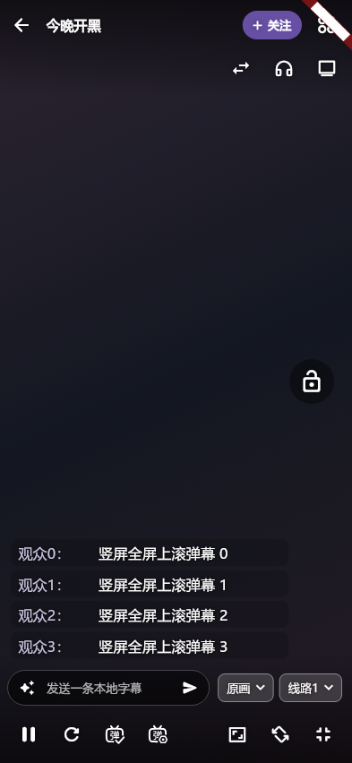

# A08.17

2026-11-04：核对当前三个开放issue及原始复现步骤，开始实现；发布、原生及真实平台证据后补。

2026-11-04：按用户指定frontend-design/art-direction，在原直播间加入可选左下角上滚，默认rolling不变。视觉沿用视频前景白色#FFFFFF与scrim黑色#000000，昵称由主题primary与视频前景混合提高对比度，行底仅18% scrim；无新大弹窗。左边12、底部避开工具栏与安全区，宽82%并不超过340，高不超过36%/320；最多6行、2行文本、8秒可见时钟，沿用字体、透明度、表情和过滤。

复用同一controller.flying/retractions，未新增平台连接；两布局共享命中/长按/按住暂停接口。实测切换设置和退出全屏不会重开播放器/弹幕，隐藏/暂停/撤回/换源、499条突发与大字号均有回归。生产组件图已经人工查看（Fake视频与数据，非真机）：

新增默认值已进入显式审计表；15语言标签和设置入口齐全。严格分析无问题、原横向渲染回归与新组件/真实页面集成通过。先前自动代码修正引入过数值类型和错误height参数，编译/分析已拦截并手工修正，未作为门禁例外。最终全量与原生设备验证仍待本版统一执行。

5.6.4+5143已正式交付。构建源码`d4bdcf962cfe9753e0c23d731dd246e970b306c7`，源PR[#199](https://github.com/wzgrx/PureLive/pull/199)；最终完整all/14、十个同源包及SHA256SUMS本地/远端摘要/匿名完整下载一致，历史更新条目保留。最终双源结果以Y01.44记录为准；未将原机和礼物剩余项冒充全部完成。

分层证据与剩余边界见[Y01.44发布验证](https://github.com/wzgrx/PureLive/blob/master/docs/Y-发布和运营/Y01-版本签名和发布/Y01.44-5.6.4竖屏弹幕与礼物小窗发布/verify.md)。
