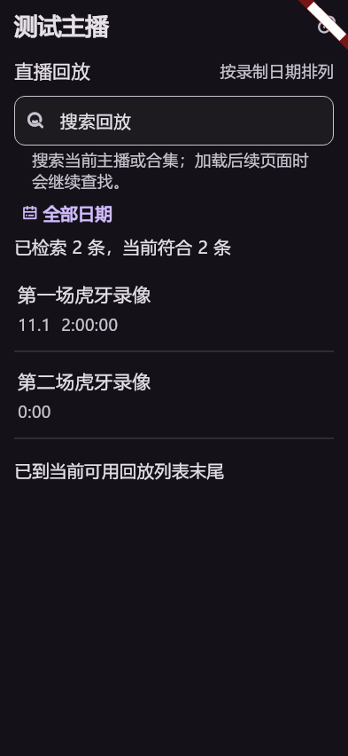
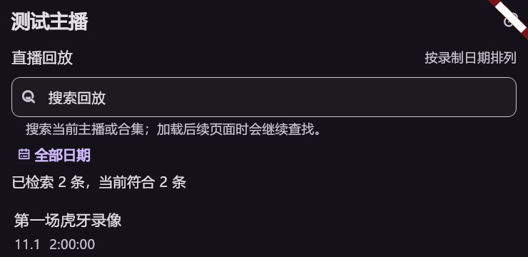
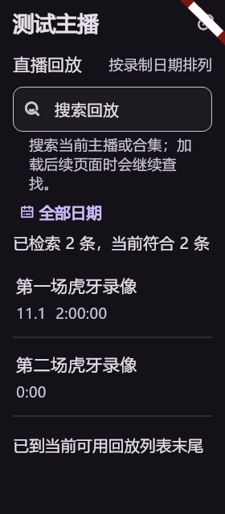
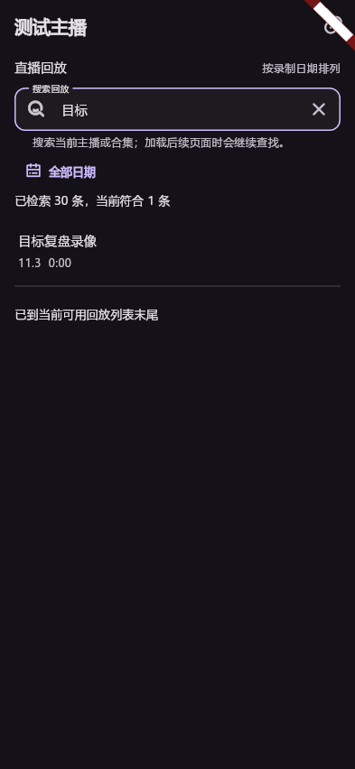
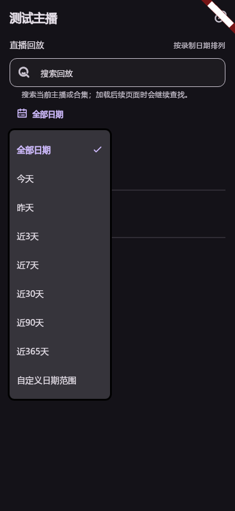

# A15.6

待验证：长列表连续加载、关键词命中跨页、空结果/取消/错误重试、日期边界/自定义、大字号/键盘、横竖屏与小窗/续看。

2026-11-04：保持原目录/直播间播放器，在ListView.builder接近底部500像素时续页，短列表补页；忙状态/来源代次防重复和串页。搜索按空白分词并同时匹配标题、主播，只逐步检索当前主播/选定合集，30个匹配后等待继续滚动；明确显示检索条数和范围，非全站搜索。每秒最多一次自动补页，三页无新记录暂停并允许重试；不固定截断1000条历史。

日期包括今天、昨天、近3/7/30/90天、近一年、全部及自定义起止日，按本地日历含首尾；无日期条目在全部日期可见，筛选时不冒充日期。失败停止自动请求，重试保留条件；退出取消，迟到结果丢弃。沿用倍速、续看、小窗与单播放器所有权。

专项30项通过（真实拖拽跨3页、不点更多、跨页命中、错误重试、退出迟到、日期边界、原播放会话）；app严格分析无问题。生产组件393×852、740×360、280×640/1.5倍字号、关键词与日期菜单截图逐张检查；窄屏范围说明改为换行，未用省略文字隐藏搜索限制。截图为测试数据组件图，非原生实测；最终完整门禁和原生验收仍随发布执行。

