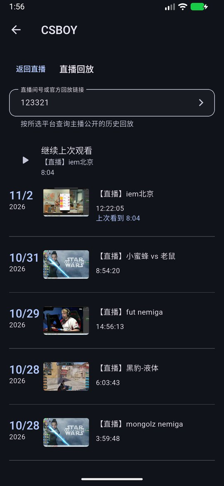
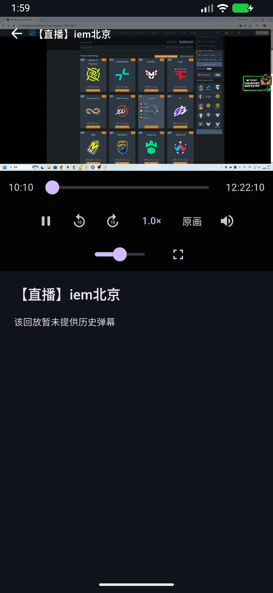
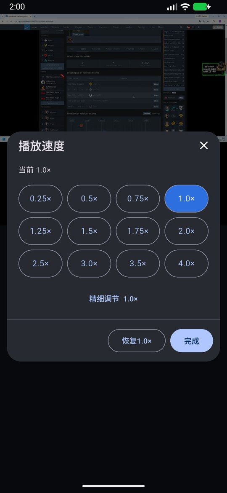
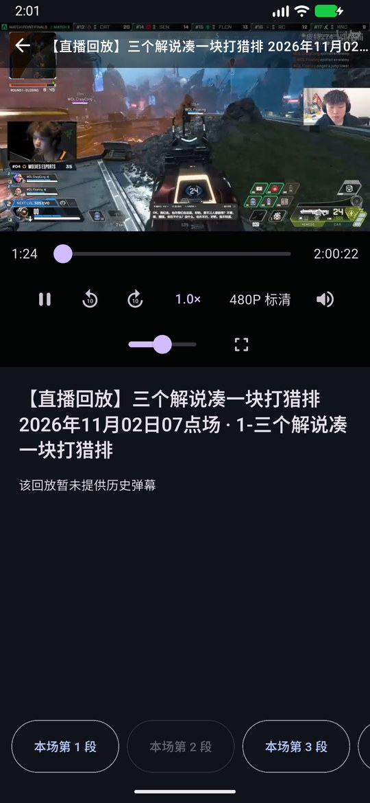
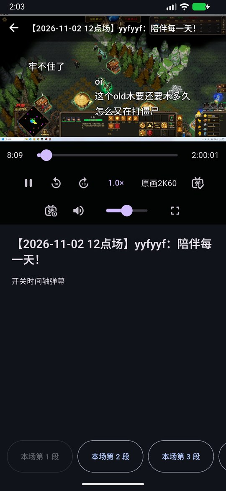

# 原生候选验证与边界

## 身份

- 冻结源码：`6a15c6a6eb65098c72a224410f3778a39ecaee40`；ARM64与x86_64均为该提交的profile构建。
- 包名：`com.mystyle.purelive.v4dev`，保留5.6.1版本号，未改正式版/更新源；两个包签名一致，复制前后SHA-256一致。
- 设备：本轮新建、独占的本地Android模拟器，`emulator-5588`，API37；竖屏约393×851dp，横屏约851×393dp。未操作已连接的手机，不等同K90或电视真机验收。
- 安装包回读SHA-256：`82aeb13b5f19b5ac35613bb879e0c7485e2998913dbc1d63f8a7a923a821614d`，与冻结x86_64包相同。
- 本文和图片为随后追加的验收文档，运行代码不因文档提交改变。合并前仍要求最终完整all/14门禁通过。

## 实际结果

1. 虎牙123321在未开播状态下取独立主播UID并加载目录；12小时回放实际出画面，恢复8:04进度后继续播放。首轮还验证4.0×、暂停、切720P后保留暂停和速度；冻结包再次出画面。
2. B站3990387实际取得“直播回放/直播录像”系列。原生播放器加载4个分P，访客实际可选480P/360P，未获权限档位禁用；实际播放、设置1.60×、暂停跳至1:15:45、切分P2、回目录续播、横屏返回竖屏均分别检查。冻结包从分P2记录继续出画面。
3. 斗鱼9999通过主播up_id加载日期目录，数字时长0正确回退至文本时长；2小时录像实际播放，3段入口与已有时间轴开关显示。冻结包从已有位置继续出画面。
4. 手机控制行按可用空间换行，音量与全屏不需横向盲找；正文标题左对齐。真实字体发现的倍速标签换行已修，冻结包12档完整单行。
5. TV目录标准焦点框、D-pad到达、确认键打开、首次确认暂停和再次确认继续通过自动回归，未把它写成真实电视遥控器验收。
6. 当前冻结包应用进程logcat缓冲区未见FATAL/Unhandled异常；这不是全场景无崩溃承诺。

## 真实运行图

以下都是冻结包在上述本地模拟器上的实际截图，非HTML提案或正式版本截图；仅缩小/压缩以符合文档图片限制。

## 尚未覆盖

- 维护者手机、原反馈者设备、真实TV硬件与遥控器；本轮Apple/Windows原生包没有重新构建验收，相关布局由Flutter测试覆盖。
- 独占模拟器以`-no-audio`启动，因此不把音轨接口/引擎入参测试等同于实际扬声器听音；历史弹幕未逐条做源时戳验收。
- 未用真实账号验证登录/VIP清晰度；不猜测或强行请求平台未提供的权限。
- 第163号原故障的设备/CDN/资源未全景复现。10秒跳转失败边界防止界面无限保持乐观进度，不表示所有跳转根因已经消除。
- 普通构建仍打印CupertinoIcons字体告警，新代码未新增该类图标引用；本轮不将Apple图标状态写成已修复。

5.6.2+5141正式交付与完整分层证据见[Y01.42验证](https://github.com/wzgrx/PureLive/blob/master/docs/Y-发布和运营/Y01-版本签名和发布/Y01.42-恢复需求与回放正式发布/verify.md)。原设备与Apple真机仍需各自验收，未覆盖范围不因发布自动转为完成。
